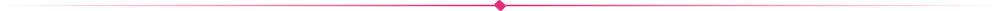

  

 

  
  
  
  

 

## ✨ About Me

> Full-Stack Developer, DevOps & Mobile Engineer, and **Computer Science undergraduate @ NSBM Green University**. I turn ideas into polished, scalable products with clean code and modern dark-mode design.

- 💻 **Building:** full-stack web apps (MERN) and Flutter mobile apps
- ☁️ **Focus:** DevOps, cloud and shipping reliable software
- 🎨 **Co-founder:** [Creative Dep](https://www.diluminda.me/), crafting brand identities and digital platforms

## 🚀 Featured Projects

<table>
  <tr>
    <td width="33%" valign="top">
      <h3>📋 SyncBoard</h3>
      Full-stack Agile Kanban task-management platform.  
      
      
      
    </td>
    <td width="33%" valign="top">
      <h3>🍔 Uni Bite</h3>
      Campus food pre-ordering app with kiosk-based top-up wallets.  
      
      
    </td>
    <td width="33%" valign="top">
      <h3>💘 Minggle</h3>
      Mobile dating app. I engineered the <b>Privacy Zone</b> geo-blocking and led core UI design.  
      
      
    </td>
  </tr>
</table>

## 🛠️ Arsenal

  
<b>Languages & Frameworks</b>

  
  
<b>Tools & Cloud</b>

  

## 📈 GitHub Activity

<table align="center" border="0" cellpadding="0" cellspacing="0">
  <tr>
    <td align="center">
      
    </td>
    <td align="center">
      
    </td>
  </tr>
</table>

  

 

  

